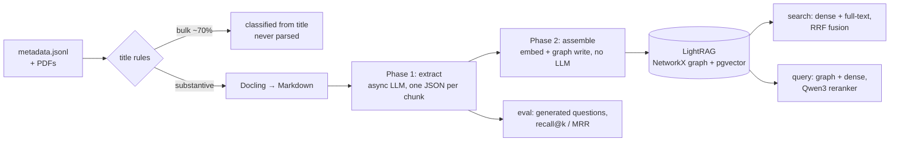

# ftx-rag

Graph RAG over the FTX bankruptcy court docket (Case 22-11068, D. Del.): tens of
thousands of filings, from claim transfers to omnibus objections, turned into a
knowledge graph and a vector index that creditors can query in plain language.

Graph RAG calls an LLM once per chunk to extract entities and relationships, so
on a corpus this size the hard problem is not retrieval wiring but the cost of
building the index. Most of this codebase exists to make that cost manageable on
one machine, and to measure whether the result actually retrieves the right
filing.

## Pipeline



| Stage | Module | Notes |
|---|---|---|
| Route & classify | `rules.py`, `classify.py` | Title prefix rules handle bulk filings; an LLM classifies the rest |
| Parse | `parse.py` | Docling with timeout and pypdf fallback; outputs are cached and reused |
| Extract | `extract.py` | Chunks scored for legal substance, extracted best-first; resumable by content hash |
| Assemble | `assemble.py` | Feeds LightRAG's `ainsert_custom_kg` in merged batches |
| Search | `search.py` | pgvector + Postgres full-text over the same chunks, fused by reciprocal rank |
| Answer | `kb.py` | LightRAG query: Qwen3-Embedding-4B (MRL-truncated) + Qwen3-Reranker-4B, both local |
| Evaluate | `evaluation/` | LLM-generated question set with leakage screening; deterministic scoring |

## Engineering notes

Numbers below are from the full-corpus run.

**Keep bulk filings out of the LLM path.** About 70% of docket entries (16,323
of ~23,500) are claim transfers, fee receipts, certificates of service and
similar forms whose title says everything. One prefix-rule table in `rules.py`
classifies them without parsing or inference. It is the only copy of those
rules; an earlier version kept a second copy in another stage and the two
silently disagreed on 435 filings.

**Cap documents before they reach the graph.** The top 1% of documents hold 39%
of all text. They are omnibus claim objections: a ruling on the first pages,
then tens of thousands of rows of creditor schedules. Graphing only the first
400K characters of each document cut the chunk count from ~162K to ~95K (−41%)
and keeps thousands of near-duplicate `CREDITOR` nodes out of the graph. Parse
output is untouched, so the cap can be raised later without re-parsing.

**Decouple extraction from graph writes.** LightRAG's `ainsert()` re-persists
the whole graph after every chunk, which capped ingestion at 2–3 chunks/min
regardless of LLM speed. Phase 1 calls the LLM directly from an async worker
pool (~45 chunks/min) and writes one JSON file per chunk; Phase 2 assembles the
graph offline in batches of 1,000, paying the persist cost once per batch.
Phase 1 produced 190,721 chunk extractions and 1.18M entities.

**Sanitise before batching.** LightRAG validates a merged batch as a whole, so
one malformed entity name rejected 1,000 extractions at a time. Names are
normalised with LightRAG's own function first, malformed model output becomes
empty lists instead of exceptions, and names too long for the Postgres column
are dropped (one over-length value used to abort a whole vector flush while the
graph accepted it, leaving nodes with no embedding).

**Turn off reasoning for extraction.** A reasoning model spent ~4,600 tokens
thinking about each small JSON extraction and often truncated the output.
Disabling it (`LLM_EXTRA_BODY`) took calls from 12–15 s to 3–5 s with valid JSON
every time.

**Search with words as well as vectors.** On a known-item eval set (38
questions, index covering ~30% of the corpus), dense retrieval put the right
filing in its top 50 for only 55% of questions, and recall barely moved from 50
to 100 candidates. The misses were retrieval failures, not ranking failures, so
no reranker could recover them. Embeddings blur exactly what docket lookups
depend on: dollar amounts, dates, party names. `search.py` runs Postgres
full-text search next to pgvector, over a stored `tsvector` column with a GIN
index added to LightRAG's own chunk table, and merges the two rankings with
reciprocal rank fusion:

| top-50 candidates contain the gold filing | recall |
|---|---|
| dense (pgvector) | 0.553 |
| full-text (OR query) | 0.763 |
| hybrid (union, RRF-ordered) | **0.868** |

The two retrievers complement each other: 11% of gold filings were found only
by dense, 32% only by full-text. `ftx-rag evaluate` reproduces the table and the
overlap breakdown. Two caveats: the questions quote specifics, which favours
lexical matching, and these numbers come from a smaller embedding model
(Qwen3-Embedding-0.6B) on a partial index.

**Measure retrieval, not vibes.** `ftx-rag questions` samples one passage per
filing, skipping templated filing types, and asks a model for the question a
creditor would type. Two filters keep the set honest: a corpus-IDF
`leak_score` sets aside questions that reuse the passage's rare wording (which
keyword search would trivially win), and a second pass drops questions that
many filings answer equally well. `ftx-rag evaluate` scores recall@k and
MRR by set membership for each retrieval mode, with no LLM in the loop, and excludes questions whose
source chunk is not yet indexed, so a partial index is not mistaken for poor
retrieval. `eval/questions_sample.jsonl` shows example output.

## Usage

Requires Python 3.11+, Docker (for Postgres + pgvector), and an
OpenAI-compatible LLM endpoint. The embedder and reranker run locally (~8 GB
each in fp16; CUDA, Apple Silicon and CPU are detected automatically).

```bash
uv venv && source .venv/bin/activate && uv pip install -e ".[dev]"
cp .env.example .env              # point LLM_* at your endpoint
docker compose up -d              # Postgres 16 + pgvector

ftx-rag process                   # classify; parse substantive PDFs
ftx-rag extract                   # Phase 1: LLM extraction (resumable)
ftx-rag assemble                  # Phase 2: embed + build graph

ftx-rag search "Emergent Fidelity Robinhood shares"   # find filings, no LLM
ftx-rag query "Who objected to the Emergent Fidelity financing motion?"
ftx-rag chat

ftx-rag questions --n 60          # build an eval set
ftx-rag evaluate                  # dense vs full-text vs hybrid: recall@k / MRR
```

### Input

The pipeline starts from `data/metadata.jsonl` (set `FTX_RAG_DATA_DIR` to move
it), one docket entry per line. Paths are relative to the data directory:

```json
{"docket_number": "Docket # 342", "document_name": "Order Granting ...", "date_filed": "01/03/2023",
 "pdf_path": "pdfs/342.pdf", "attachments": ["pdfs/342_1.pdf"]}
```

This repository ships no filings or derived data: they name individual creditors.

## Development

```bash
pytest       # unit tests; no models, database or network needed
ruff check .
```

## Disclaimer

Not affiliated with FTX, the debtors, or the court. Nothing here is legal advice.

## License

MIT
